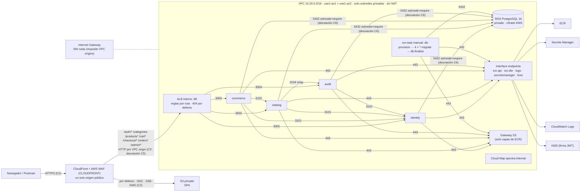

# ADR-AWS-05 — Arquitectura definitiva del laboratorio AWS e infraestructura como código (Terraform)

- **Estado:** propuesta (pendiente de aprobación del propietario). Implementada en la rama local `feature/aws-pr5-terraform` (PR-5). **No se ha aplicado**: no se creó ningún recurso AWS.
- **Fecha:** 2026-11-21 · **Código de referencia:** `main` = `a0f8052` (PR #12–#15 fusionados).
- **Decisiones del propietario en las que se basa:** borde CloudFront → ALB interno y JWT con KMS (2026-11-20); Internet Gateway solo por requisito de VPC origins, desviaciones C5/C6 como propuesta y `TRUST_PROXY` configurable sin valor definitivo (2026-11-21).
- **Relacionado:** [ADR-AWS-01](ADR-AWS-01-aprovisionamiento-rds.md), [ADR-AWS-02](ADR-AWS-02-firma-jwt-kms.md), [ADR-AWS-03](ADR-AWS-03-imagenes-runtime.md), [ADR-AWS-04](ADR-AWS-04-borde-ip-csp-readiness.md); plan de despliegue y diagnóstico AWS (`docs/operacion-y-aws/03` y `04`, hoy solo en la rama local `docs/operacion-y-aws`); código en [`infra/terraform/`](../../infra/terraform/README.md).

## Contexto

El plan de despliegue AWS (§17) asigna a PR-5 el Terraform del laboratorio. La arquitectura académica de la Fase 2 (AD-02/AD-03) usaba API Gateway REST + VPC Link v2 + WAF regional y `X-Origin-Verify`; el 2026-11-20 el propietario eligió **CloudFront VPC origin → ALB interno**. Al verificarlo contra la documentación de AWS (2026-11-21) aparecieron tres restricciones que el plan no recogía:

1. «You need to add an internet gateway to the VPC that has your VPC origin resources… The internet gateway is not used for routing traffic to origins inside the subnet, and you don't need to update the routing policies.» Esto contradice AD-05 («sin IGW ni NAT»).
2. En us-east-1, VPC origins no admite la zona **`use1-az3`**.
3. El ALB se abre al prefix list `com.amazonaws.global.cloudfront.origin-facing` o al SG gestionado `CloudFront-VPCOrigins-Service-SG` (este último solo existe después de crear el VPC origin). VPC origins no tiene costo adicional.

Fuentes: [Restrict access with VPC origins](https://docs.aws.amazon.com/AmazonCloudFront/latest/DeveloperGuide/private-content-vpc-origins.html) y [anuncio de VPC origins](https://aws.amazon.com/about-aws/whats-new/2024/11/amazon-cloudfront-vpc-origins/).

## Arquitectura propuesta

Las conexiones C3 (CloudFront → API Gateway) y C4 (API Gateway → ALB) de la Fase 2 se sustituyen por un solo salto CloudFront → VPC origin → ALB interno (C3'). C7–C9 se mantienen. C10 (OIDC) queda para PR-6.

## Decisiones

| ID              | Decisión                                                                                                                                                                                                                                         | Justificación y controles                                                                                                                                                                                                                                                                                                                                                                                                                                                                                                           |
| --------------- | ------------------------------------------------------------------------------------------------------------------------------------------------------------------------------------------------------------------------------------------------ | ----------------------------------------------------------------------------------------------------------------------------------------------------------------------------------------------------------------------------------------------------------------------------------------------------------------------------------------------------------------------------------------------------------------------------------------------------------------------------------------------------------------------------------- |
| **D-AWS-05-01** | **Borde: CloudFront VPC origin → ALB interno** (confirma la decisión del 2026-11-20 y sustituye AD-02/AD-03 en el laboratorio).                                                                                                                  | Un único origen público para la SPA y las API: las cookies `__Host-` (sin `Domain`, `Secure`, `SameSite=Strict`) y el CSRF con comprobación de `Origin` funcionan sin cambios (AWS-05). El ALB no tiene IP pública, de modo que no hace falta `X-Origin-Verify` ni un segundo WAF. API Gateway queda fuera.                                                                                                                                                                                                                         |
| **D-AWS-05-02** | **Internet Gateway asociado a la VPC exclusivamente como requisito de VPC origins** (modifica AD-05, aprobado el 2026-11-21).                                                                                                                    | Ninguna tabla de rutas tiene `0.0.0.0/0` ni `::/0`; no hay subredes públicas, NAT ni IP públicas (`map_public_ip_on_launch = false`, `assign_public_ip = false`, `publicly_accessible = false`). Lo comprueban `terraform test` y `scripts/static-checks.sh`. El IGW lleva la etiqueta `Purpose = cloudfront-vpc-origins-requirement-no-routes`. **Riesgo residual:** un cambio posterior que añada una ruta al IGW expondría las subredes. Mitigación propuesta: regla de AWS Config o alarma sobre `CreateRoute` (fuera de PR-5). |
| **D-AWS-05-03** | **Subredes fijadas por AZ ID** (`use1-az1` y `use1-az2` por defecto); `use1-az3` se rechaza en la validación.                                                                                                                                    | Los nombres de AZ cambian entre cuentas; los AZ ID no. El ALB exige 2 AZ.                                                                                                                                                                                                                                                                                                                                                                                                                                                           |
| **D-AWS-05-04** | **Un rol de ejecución por carga de trabajo (10) y rol de tarea solo para Identity.**                                                                                                                                                             | Cada rol de ejecución se genera desde la misma definición que la task definition: descarga solo su imagen, escribe solo en su log group y lee solo los secretos que inyecta. Identity tiene `kms:Sign` (condiciones `kms:SigningAlgorithm = ECDSA_SHA_256` y `kms:MessageType = RAW`) y `kms:GetPublicKey` sobre la clave de JWT. Catalog, Commerce, Audit y las tareas de operación no reciben credenciales de AWS. ECS Exec desactivado.                                                                                          |
| **D-AWS-05-05** | **Secretos fuera del state:** `ephemeral "random_password"` + `secret_string_wo` / `secret_string_wo_version`; el maestro de RDS lo gestiona RDS (`manage_master_user_password`).                                                                | Verificado con Terraform 1.17.2, `hashicorp/aws` 6.70.0 y `hashicorp/random` 3.9.1 (`terraform providers schema -json`). Los valores no aparecen en el state, el plan, los tfvars ni los logs de Terraform. `secret_string_wo_version` es un número normal; nunca recibe un valor efímero (issue [#44590](https://github.com/hashicorp/terraform-provider-aws/issues/44590)). Rotación manual por versión.                                                                                                                          |
| **D-AWS-05-06** | **Desviación de laboratorio C5 (propuesta): HTTP dentro de la VPC** en CloudFront VPC origin → ALB, ALB → tareas y entre servicios (3101/3102/3104).                                                                                             | **No equivale a TLS de extremo a extremo.** Controles compensatorios: ALB interno sin IP pública y SG con origen único (CloudFront); SG por servicio y por puerto (ningún CIDR, solo SG); subredes sin ruta a Internet; tokens internos por alcance; WAF y TLS público en CloudFront; Flow Logs. En producción: TLS hasta el ALB (certificado ACM) y hasta las tareas (Service Connect TLS o en la aplicación).                                                                                                                     |
| **D-AWS-05-07** | **Desviación de laboratorio C6 (propuesta): `sslmode=require`** en las URL de Prisma y en `PGSSLMODE` de las tareas `db-*`; `rds.force_ssl = 1` en el servidor.                                                                                  | **Cifra el transporte, pero NO verifica el certificado ni el nombre del servidor:** no protege frente a una suplantación del servidor dentro de la VPC. **No equivale a `verify-full`**, que exige incluir el bundle de CA de RDS en las imágenes (cambio de imagen, fuera de PR-5).                                                                                                                                                                                                                                                |
| **D-AWS-05-08** | **Parameter group:** `rds.force_ssl=1`, `log_statement=none`, `log_min_duration_statement=-1`, `log_connections=1`, `log_disconnections=1` y **`log_min_error_statement=panic`**.                                                                | Requisitos de ADR-AWS-01. `panic` mitiga su riesgo residual: un `ALTER ROLE` fallido no escribe su texto (con la contraseña) en los logs de RDS ni en CloudWatch. Coste: los errores de SQL se registran sin la sentencia.                                                                                                                                                                                                                                                                                                          |
| **D-AWS-05-09** | **`TRUST_PROXY` configurable, con `"false"` por defecto** (seguro: no confía en `X-Forwarded-For`). La validación rechaza `true`.                                                                                                                | El valor definitivo depende de la prueba **P10** con la cadena real CloudFront → ALB → ECS. Alternativas documentadas en el README del entorno: `"2"` (dos saltos) o la CIDR de la VPC (solo si el ALB ve IP privadas de la VPC; la documentación de VPC origins sugiere que ve las IP de CloudFront, lo que haría incorrecta la recomendación de ADR-AWS-04). Con `"false"`, los límites por IP de la aplicación se vuelven globales; WAF sigue limitando por la IP real del visitante.                                            |
| **D-AWS-05-10** | **Ciclo de vida en dos fases y migraciones manuales.**                                                                                                                                                                                           | Primer `apply` con `service_desired_count = 0` → `run-task` en serie (`db-provision` → 4 × `*-migrate` → `db-finalize`) → segundo `apply` con `1`. Terraform solo define las tareas; nada las lanza al aplicar ni al arrancar un servicio, sin `local-exec` ni `null_resource` (DT-09, concurrencia y recuperación controladas por el operador).                                                                                                                                                                                    |
| **D-AWS-05-11** | **State remoto en S3** con bloqueo nativo (`use_lockfile`), SSE-KMS con clave propia, versionado, Block Public Access, solo TLS y `prevent_destroy`; bootstrap en un directorio aparte, **no aplicado**.                                         | El state no contiene secretos (D-AWS-05-05), pero sí metadatos de la cuenta.                                                                                                                                                                                                                                                                                                                                                                                                                                                        |
| **D-AWS-05-12** | **VPC interface endpoints en lugar de NAT**, en 1 AZ por defecto; gateway de S3 con política restringida al bucket de capas de ECR.                                                                                                              | Mismo costo aproximado que una NAT, sin salida a Internet (AD-05). Con 1 AZ se acepta la pérdida de disponibilidad (AWS-28).                                                                                                                                                                                                                                                                                                                                                                                                        |
| **D-AWS-05-13** | **CMK dedicada para la SPA** (solo esta distribución puede descifrar) y CMK de datos para RDS, secretos, ECR, logs y SNS.                                                                                                                        | Corrige el hallazgo HIGH de Trivy (AWS-0132) sin ampliar los principales de la clave de datos.                                                                                                                                                                                                                                                                                                                                                                                                                                      |
| **D-AWS-05-14** | **Clave pública de JWT** leída de KMS (`aws_kms_public_key`) e inyectada como `IDENTITY_PUBLIC_KEY_PEM` en `environment`.                                                                                                                        | No es un secreto (ADR-AWS-02, D-AWS-02-04); evita el paso manual con `openssl`.                                                                                                                                                                                                                                                                                                                                                                                                                                                     |
| **D-AWS-05-15** | **WAF:** reglas rate-based por IP (`/auth/*` y global) y las reglas administradas IP Reputation, Known Bad Inputs, Common y SQLi. Los logs ocultan `cookie`, `x-csrf-token` y `authorization`.                                                   | Protección principal frente a abuso (AWS-11, AWS-15).                                                                                                                                                                                                                                                                                                                                                                                                                                                                               |
| **D-AWS-05-16** | **Dos políticas de cabeceras de respuesta:** la de la SPA (CSP de producción igual a la de `vite build`, más `frame-ancestors`) y la de las API (sin CSP, para no sustituir la de Helmet). HSTS de 1 año con `includeSubDomains`, sin `preload`. | AWS-16. `/health*`, `/docs*` e `/internal/*` no se enrutan (AWS-17, AWS-18).                                                                                                                                                                                                                                                                                                                                                                                                                                                        |
| **D-AWS-05-17** | **SG del ALB en dos fases:** `alb_ingress_source = "prefix_list"` y después `"vpc_origin_sg"`.                                                                                                                                                   | El SG gestionado restringe la entrada a las distribuciones propias, pero solo existe después de crear el VPC origin.                                                                                                                                                                                                                                                                                                                                                                                                                |

## Coherencia con el marco académico (sin rehacer las matrices)

| Capa (modelo de siete capas) | Controles de PR-5                                                                                                                                                |
| ---------------------------- | ---------------------------------------------------------------------------------------------------------------------------------------------------------------- |
| 1. Datos                     | RDS cifrado con CMK, TLS obligatorio (C6 con desviación), copias de 7 días, secretos con KMS fuera del state, CMK para la SPA y el state                         |
| 2. Aplicación                | Un solo origen público (cookies `__Host-`, CSRF), rutas explícitas en CloudFront y el ALB, `/docs` e `/internal` no publicados, `TRUST_PROXY` seguro por defecto |
| 3. Host                      | Imágenes `runtime` sin devDependencies (ADR-AWS-03), raíz de solo lectura, capacidades eliminadas, sin ECS Exec, etiquetas inmutables y escaneo en ECR           |
| 4. Red interna               | Subredes privadas, IGW sin rutas, SG por servicio y puerto, endpoints privados, Flow Logs                                                                        |
| 5. Perímetro cloud           | CloudFront, WAF (reglas administradas y rate-based), cabeceras de seguridad, VPC origin                                                                          |
| 6. Física                    | Responsabilidad compartida de AWS (sin cambios)                                                                                                                  |
| 7. Políticas                 | Mínimo privilegio en IAM, rotación documentada, presupuesto con alertas, etiquetas, validación estática reproducible                                             |

Amenazas STRIDE cubiertas: _Spoofing_ (CSRF/Origin, TRUST_PROXY sin confianza indiscriminada), _Tampering_ (TLS público, imágenes inmutables), _Repudiation_ (logs de WAF, ALB y Flow Logs, Audit), _Information disclosure_ (secretos fuera del state, subredes privadas, redacción en los logs), _DoS_ (WAF rate-based) y _Elevation of privilege_ (roles por carga, sin credenciales en tres de los cuatro servicios). Los controles ISO/IEC 27001:2022 relacionados (A.8.20–A.8.24 redes y criptografía; A.8.9 configuración; A.5.15–A.5.18 accesos) se trazarán en la matriz maestra cuando el propietario lo autorice.

## Consecuencias

- **Nada está validado en AWS.** Las pruebas P1–P13 del plan siguen pendientes; P10 decide `TRUST_PROXY`.
- La estimación de costos se mantiene en ≈ 135–145 USD/mes 24/7, **sin verificar** (ver `infra/terraform/docs/03-costos.md`).
- PR-6 debe publicar 9 imágenes por commit (4 `runtime`, 4 `migrate` y `db-ops`) con la plataforma de `cpu_architecture`, y crear el rol OIDC de despliegue (no se crea en PR-5).
- La tarea de verificación DT-09 (`verify-db-isolation.mjs`) no se define en PR-5: ninguna imagen publicada contiene el script (decisión de PR-6/PR-7).
- `rollback-service-roles.sql` sigue sin variante RDS (ADR-AWS-01): el rollback de base de datos es restaurar un snapshot en una instancia nueva.
