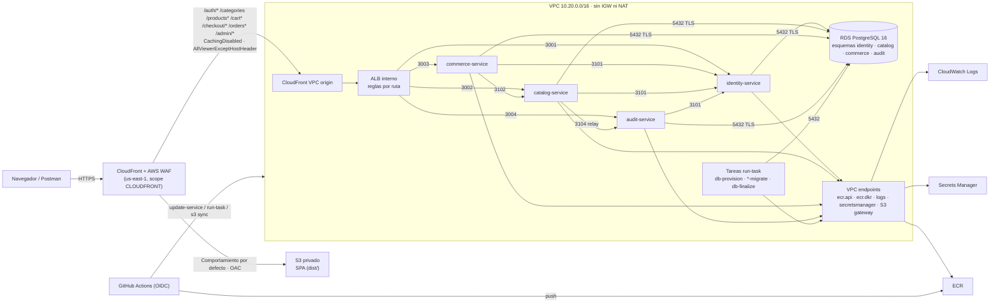

# Plan de despliegue AWS — laboratorio académico SPECTRA Shop

- **Estado:** **PROPUESTA**. Decisiones del propietario del 2026-11-20: borde CloudFront → ALB interno y firma JWT con AWS KMS (§18). No se ha creado ningún recurso, publicado ninguna imagen ni ejecutado ningún comando AWS. Los cambios de arquitectura respecto a la Fase 2 requieren la aprobación del propietario.
- **Fecha:** 2026-11-20 · **Código de referencia:** `main` = `2a27350`
- **Requisito previo:** resolver los bloqueantes de código e infraestructura del [diagnóstico](03-diagnostico-aws.md) (AWS-01, AWS-02, AWS-03 y AWS-07).
- **Región:** `us-east-1` (AD-01: el WAF de CloudFront y ACM para CloudFront viven allí).

Los comandos `aws …` de este documento son **ilustrativos**. Deben ejecutarse con credenciales temporales de IAM Identity Center o del rol OIDC, y preferiblemente codificarse en Terraform (validación V1 de la Fase 2). Los identificadores `<…>` son marcadores.

---

## 1. Laboratorio frente a producción

| Dimensión     | Laboratorio académico (este plan)                                                                          | Producción (fuera de alcance)                                         |
| ------------- | ---------------------------------------------------------------------------------------------------------- | --------------------------------------------------------------------- |
| Objetivo      | Demostrar la arquitectura y los controles (Fase 5), con datos sintéticos y por tiempo limitado             | Servicio continuo con datos reales                                    |
| Dominio y TLS | `*.cloudfront.net` con el certificado de CloudFront (sin control del TLS mínimo) o dominio propio opcional | Dominio propio, ACM y política `TLSv1.2_2021` o superior              |
| Cómputo       | 1 tarea por servicio, sin autoscaling, subredes en 2 AZ                                                    | ≥ 2 tareas por servicio en 2 AZ y autoscaling                         |
| Base de datos | RDS `db.t4g.micro` Single-AZ, 20 GB gp3, copias de 1–7 días                                                | Multi-AZ, clase dimensionada, PITR de 35 días, réplicas si hace falta |
| Firma de JWT  | PEM en Secrets Manager (decisión AWS-01) o KMS                                                             | **KMS obligatorio** (AD-08)                                           |
| TLS interno   | HTTP en subredes privadas (desviación de C5)                                                               | TLS de extremo a extremo                                              |
| Auditoría     | Solo `PRODUCT_CREATED` llega a Audit; el resto, vía logs                                                   | DT-10 completo (todas las outbox)                                     |
| Imágenes      | Sin devDependencies (AWS-08) y escaneadas                                                                  | Además firmadas y con SBOM por imagen                                 |
| Ciclo de vida | Se destruye al terminar la ventana de pruebas                                                              | Permanente, con plan de continuidad                                   |
| Presupuesto   | AWS Budgets con alertas a 25 y 50 USD                                                                      | Presupuesto operativo                                                 |

## 2. Arquitectura propuesta para el laboratorio



### 2.1 Contraste con la arquitectura académica (Fase 2)

| Decisión de la Fase 2                                                                       | Realidad del código                                                                                 | Propuesta para el laboratorio                                                                                                                                                                                                                                                                                                          | ¿Requiere aprobación?                     |
| ------------------------------------------------------------------------------------------- | --------------------------------------------------------------------------------------------------- | -------------------------------------------------------------------------------------------------------------------------------------------------------------------------------------------------------------------------------------------------------------------------------------------------------------------------------------- | ----------------------------------------- |
| AD-01 us-east-1                                                                             | —                                                                                                   | Se mantiene                                                                                                                                                                                                                                                                                                                            | No                                        |
| AD-02/AD-03 API Gateway REST + VPC Link v2 + ALB interno + WAF regional + `X-Origin-Verify` | —                                                                                                   | **CloudFront VPC origin → ALB interno**. El ALB no tiene IP pública, así que no hace falta verificar el origen con una cabecera secreta, y desaparecen API Gateway y el segundo WAF. _Alternativa fiel a la Fase 2:_ conservar AD-02/03 con `/api/{proxy+}` hacia el ALB, quitando el prefijo `/api` en la integración (≈ +15 USD/mes) | **Sí** (sustituye AD-02/AD-03)            |
| Una sola «API NestJS» en ECS (0.5 vCPU/1 GB)                                                | **4 microservicios** con listeners internos                                                         | 4 servicios ECS con Cloud Map para el tráfico entre ellos                                                                                                                                                                                                                                                                              | No (adapta el diseño a la implementación) |
| Prefijo `/api/*` en el mismo dominio (AD-07)                                                | Las rutas no tienen prefijo (`/auth`, `/products`, `/cart`…)                                        | Mismo dominio sin prefijo: un comportamiento de CloudFront por grupo de rutas. La SPA usa rutas hash (`#/…`), así que no hay colisión con las rutas de la API                                                                                                                                                                          | Sí (detalle de AD-07)                     |
| AD-04 Fargate en subred privada                                                             | Compatible                                                                                          | Se mantiene                                                                                                                                                                                                                                                                                                                            | No                                        |
| AD-05 sin IGW ni NAT, con VPC endpoints                                                     | Las aplicaciones no necesitan salida a Internet                                                     | Se mantiene (4 endpoints de interfaz y el gateway de S3; KMS solo si se usa AD-08)                                                                                                                                                                                                                                                     | No                                        |
| AD-06 RDS Single-AZ                                                                         | Una base con 4 esquemas y 8 roles                                                                   | Se mantiene. **Requiere la variante RDS de DT-09** (AWS-02)                                                                                                                                                                                                                                                                            | No                                        |
| AD-08 JWT firmado por KMS                                                                   | Adaptador KMS implementado en la rama local PR-2 ([ADR-AWS-02](../adr/ADR-AWS-02-firma-jwt-kms.md)) | **KMS también en el laboratorio** (decisión del 2026-11-20)                                                                                                                                                                                                                                                                            | No (se cumple AD-08)                      |
| AD-09 Identity Center + OIDC                                                                | La CI no despliega                                                                                  | Se mantiene; nuevo workflow de publicación                                                                                                                                                                                                                                                                                             | No                                        |
| C5 HTTPS ALB → ECS 8443                                                                     | Los servicios escuchan HTTP                                                                         | HTTP dentro de la VPC (desviación documentada, AWS-31)                                                                                                                                                                                                                                                                                 | **Sí**                                    |
| C6 TLS `verify-full` hacia RDS                                                              | Sin `sslmode` y sin CA en la imagen                                                                 | `sslmode=require` y `force_ssl`; `verify-full` cuando la imagen incluya la CA                                                                                                                                                                                                                                                          | Sí (desviación temporal)                  |

Si CloudFront VPC origins no estuviera disponible en la cuenta (**verificar**), la alternativa equivalente es un ALB público cuyo security group solo admite el prefix list `com.amazonaws.global.cloudfront.origin-facing`, más una regla del listener que exige una cabecera secreta `X-Origin-Verify` rotada desde Secrets Manager.

## 3. Servicios AWS necesarios

| Servicio                   | Uso                                                                                                                     | Notas                                                                            |
| -------------------------- | ----------------------------------------------------------------------------------------------------------------------- | -------------------------------------------------------------------------------- |
| IAM Identity Center        | Acceso humano con MFA                                                                                                   | Conjuntos de permisos `Lab-Admin` y `Lab-ReadOnly`                               |
| AWS Budgets                | Alertas de costo                                                                                                        | 25 y 50 USD **antes** del primer recurso                                         |
| KMS                        | CMK `alias/spectra-data` (RDS, logs y secretos) y clave asimétrica `alias/spectra-jwt` (`ECC_NIST_P256`, `SIGN_VERIFY`) | AD-08                                                                            |
| VPC                        | 4 subredes privadas en 2 AZ, sin IGW ni NAT                                                                             | Gateway endpoint de S3 (gratuito)                                                |
| VPC interface endpoints    | `ecr.api`, `ecr.dkr`, `logs`, `secretsmanager`, `kms`                                                                   | `kms` es necesario: Identity firma con KMS                                       |
| ECR                        | 5 repositorios: 4 servicios y `db-ops`                                                                                  | Etiquetas inmutables y escaneo al publicar                                       |
| RDS for PostgreSQL 16      | Base `spectra_shop`                                                                                                     | Secreto del maestro gestionado por RDS, cifrado KMS y `PubliclyAccessible=false` |
| Secrets Manager            | 14 secretos (§9)                                                                                                        |                                                                                  |
| CloudWatch Logs y alarmas  | Logs `awslogs`, filtros de métricas y alarmas                                                                           | Retención de 30 días en el laboratorio                                           |
| ECS (Fargate)              | Clúster `spectra-lab`, 4 servicios y 7 task definitions de operación                                                    | Container Insights opcional (con costo)                                          |
| AWS Cloud Map              | Espacio DNS privado `spectra.internal`                                                                                  | Descubrimiento entre servicios                                                   |
| Elastic Load Balancing     | ALB **interno** con 4 target groups                                                                                     | Tipo de destino `ip`                                                             |
| S3                         | Bucket privado para la SPA                                                                                              | Block Public Access, versionado, OAC                                             |
| CloudFront                 | Distribución única (SPA y API)                                                                                          | VPC origin hacia el ALB, response headers policy                                 |
| AWS WAF                    | Web ACL de ámbito CLOUDFRONT                                                                                            | Reglas administradas y rate-based                                                |
| GitHub OIDC provider + IAM | Despliegue sin claves de larga duración                                                                                 | Confianza limitada a `repo:<org>/spectra-shop:ref:refs/heads/main`               |
| Route 53 + ACM (opcional)  | Dominio propio                                                                                                          | Necesario para TLS ≥ 1.2 en el borde                                             |

## 4. Dependencias entre componentes

```text
Budgets, Identity Center ──┐
KMS CMK ───────────────────┼─▶ VPC + subredes + SG + endpoints ─▶ RDS (subnet group, parameter group)
                           │                                     │
ECR repos ◀── CI (imágenes)│                                     ▼
                           └─▶ Secrets Manager ◀── contraseñas de los roles · tokens · claves · URL de BD
                                                                 │
IAM (execution, task, ops, deploy) ─▶ ECS cluster + Cloud Map ─▶ task definitions
                                                                 │
                         run-task: db-provision ▶ 4 × *-migrate ▶ db-finalize   (requiere RDS + secretos + ECR)
                                                                 │
ALB interno + target groups ─▶ CloudFront (VPC origin + S3 OAC) + WAF ─▶ dominio conocido
                                                                 │
                    ECS services (CORS_ORIGINS = dominio) ─▶ build Web (VITE_* = dominio) ─▶ s3 sync ─▶ invalidación
```

El dominio de CloudFront debe existir **antes** de fijar `CORS_ORIGINS` en los servicios y antes de compilar la Web, así que la distribución se crea antes que los servicios ECS.

## 5. Orden exacto de aprovisionamiento

| Paso | Acción                                                                                                                                                                                                                               | Verificación                                   |
| ---- | ------------------------------------------------------------------------------------------------------------------------------------------------------------------------------------------------------------------------------------ | ---------------------------------------------- |
| 0    | Autorización del propietario; PR de bloqueantes fusionados; Budgets 25/50 USD; Identity Center con MFA; región `us-east-1`                                                                                                           | Alertas de Budgets activas                     |
| 1    | KMS: CMK `alias/spectra-data` con rotación anual                                                                                                                                                                                     | `aws kms describe-key`                         |
| 2    | VPC `10.20.0.0/16`; subredes de aplicación `10.20.1.0/24` (a) y `10.20.2.0/24` (b); de datos `10.20.11.0/24` y `10.20.12.0/24`; tablas de rutas sin `0.0.0.0/0`                                                                      | Ninguna ruta a IGW o NAT                       |
| 3    | Security groups (§7) y endpoints: S3 gateway; `ecr.api`, `ecr.dkr`, `logs` y `secretsmanager` con DNS privado                                                                                                                        | Endpoints `available`                          |
| 4    | ECR: 5 repositorios inmutables con escaneo al publicar                                                                                                                                                                               | `describe-repositories`                        |
| 5    | CI publica las imágenes (§10)                                                                                                                                                                                                        | Escaneo sin CRITICAL/HIGH sin justificar       |
| 6    | RDS: subnet group (datos), parameter group (`rds.force_ssl=1`, `log_connections=1`), instancia `db.t4g.micro` PostgreSQL 16, cifrado con la CMK, maestro gestionado en Secrets Manager, copias de 7 días y protección contra borrado | Estado `available`; `PubliclyAccessible=false` |
| 7    | Secrets Manager: 14 secretos (§9), generados sin mostrarlos                                                                                                                                                                          | `list-secrets` (solo nombres)                  |
| 8    | Log groups `/spectra/lab/<servicio>` cifrados, con retención de 30 días                                                                                                                                                              | —                                              |
| 9    | IAM: rol de ejecución, roles de tarea por servicio, rol `ops` y rol de despliegue OIDC (§8)                                                                                                                                          | IAM Access Analyzer sin hallazgos externos     |
| 10   | ECS: clúster `spectra-lab` y espacio Cloud Map `spectra.internal`                                                                                                                                                                    | —                                              |
| 11   | Task definitions: `db-provision`, `identity-migrate`, `catalog-migrate`, `commerce-migrate`, `audit-migrate`, `db-finalize` y las 4 de servicio                                                                                      | Revisión: ningún secreto en `environment`      |
| 12   | **Migración controlada** (§11): provision → 4 migraciones → finalize → verificación DT-09                                                                                                                                            | Todos los `exitCode` = 0                       |
| 13   | ALB interno, 4 target groups (`/health`, puerto de tráfico) y reglas del listener (§6.2)                                                                                                                                             | —                                              |
| 14   | S3 (privado, versionado), CloudFront (VPC origin, OAC, comportamientos §6.1, response headers policy) y Web ACL de WAF                                                                                                               | Dominio `dxxxx.cloudfront.net` conocido        |
| 15   | ECS services (desired 1, service discovery, circuit breaker con rollback, `CORS_ORIGINS=https://<dominio>`)                                                                                                                          | Targets `healthy`; servicios `steady state`    |
| 16   | Web: build con `VITE_*=https://<dominio>`, `s3 sync` e invalidación                                                                                                                                                                  | `GET /` 200 con la SPA                         |
| 17   | Pruebas posteriores al despliegue (§13) y evidencias (§14)                                                                                                                                                                           | Checklist completo                             |

## 6. Publicación del frontend y enrutamiento de la API

### 6.1 Comportamientos de CloudFront

| Patrón de ruta                                            | Origen           | Caché                                                  | Origin request policy                                                                                  | Métodos            |
| --------------------------------------------------------- | ---------------- | ------------------------------------------------------ | ------------------------------------------------------------------------------------------------------ | ------------------ |
| `/auth/*`                                                 | VPC origin (ALB) | `CachingDisabled`                                      | `AllViewerExceptHostHeader` (reenvía `Cookie`, `Origin`, `X-CSRF-Token`, `Idempotency-Key` y la query) | Todos              |
| `/categories`                                             | ALB              | `CachingDisabled`                                      | ídem                                                                                                   | GET, HEAD, OPTIONS |
| `/products`, `/products/*`                                | ALB              | `CachingDisabled`                                      | ídem                                                                                                   | GET, HEAD, OPTIONS |
| `/cart`, `/cart/*`, `/checkout/*`, `/orders`, `/orders/*` | ALB              | `CachingDisabled`                                      | ídem                                                                                                   | Todos              |
| `/admin/*`                                                | ALB              | `CachingDisabled`                                      | ídem                                                                                                   | Todos              |
| Por defecto (`*`)                                         | S3 (OAC)         | `CachingOptimized` (salvo `index.html`, con TTL corto) | —                                                                                                      | GET, HEAD          |

Hay 10 comportamientos más el de por defecto (el límite de CloudFront es 25). `/health`, `/docs` y `/docs-json` **no se enrutan**: caen en S3 y devuelven 403/404, así que no se exponen.

### 6.2 Reglas del listener del ALB (HTTP 80, interno)

| Prioridad   | Condición `path-pattern`                                                          | Destino                               |
| ----------- | --------------------------------------------------------------------------------- | ------------------------------------- |
| 10          | `/auth/*`                                                                         | `tg-identity` (3001)                  |
| 20          | `/categories`, `/products`, `/products/*`, `/admin/products`, `/admin/products/*` | `tg-catalog` (3002)                   |
| 30          | `/cart`, `/cart/*`, `/checkout/*`, `/orders`, `/orders/*`                         | `tg-commerce` (3003)                  |
| 40          | `/admin/orders`, `/admin/orders/*`                                                | `tg-commerce` (3003)                  |
| 50          | `/admin/audit-events`, `/admin/audit-events/*`                                    | `tg-audit` (3004)                     |
| Por defecto | —                                                                                 | Respuesta fija 404 `application/json` |

Health check de cada target group: `GET /health/ready` (comprueba PostgreSQL; PR-4, [ADR-AWS-04](../adr/ADR-AWS-04-borde-ip-csp-readiness.md)), matcher `200`, intervalo de 15 s. Los puertos internos 3101, 3102 y 3104 **nunca** se registran en el ALB.

### 6.3 Build y publicación de la Web

```bash
# Raíz del repo (en CI). <dominio> = dxxxx.cloudfront.net o el dominio propio.
export VITE_IDENTITY_API_URL=https://<dominio> VITE_CATALOG_API_URL=https://<dominio> \
       VITE_COMMERCE_API_URL=https://<dominio> VITE_AUDIT_API_URL=https://<dominio>
npm ci && npm run build --workspace @spectra/contracts && npm run build --workspace @spectra/web
aws s3 sync apps/web/dist "s3://<bucket-spa>" --delete
aws cloudfront create-invalidation --distribution-id <id> --paths '/index.html' '/'
```

## 7. Networking y security groups

| SG                      | Entrada                                                                                                    | Salida                                                                     |
| ----------------------- | ---------------------------------------------------------------------------------------------------------- | -------------------------------------------------------------------------- |
| `sg-alb`                | 80 desde el origen VPC de CloudFront (**verificar** el SG o el prefix list que usa CloudFront VPC origins) | 3001→`sg-identity`, 3002→`sg-catalog`, 3003→`sg-commerce`, 3004→`sg-audit` |
| `sg-identity`           | 3001 desde `sg-alb`; **3101** desde `sg-catalog`, `sg-commerce` y `sg-audit`                               | 5432→`sg-rds`; 443→`sg-endpoints`; 443→prefix list de S3                   |
| `sg-catalog`            | 3002 desde `sg-alb`; **3102** desde `sg-commerce`                                                          | 3101→`sg-identity`; 3104→`sg-audit`; 5432; 443                             |
| `sg-commerce`           | 3003 desde `sg-alb`                                                                                        | 3101→`sg-identity`; 3102→`sg-catalog`; 5432; 443                           |
| `sg-audit`              | 3004 desde `sg-alb`; **3104** desde `sg-catalog`                                                           | 3101→`sg-identity`; 5432; 443                                              |
| `sg-ops` (tareas de BD) | —                                                                                                          | 5432→`sg-rds`; 443→`sg-endpoints`; 443→S3                                  |
| `sg-rds`                | 5432 desde los 4 SG de servicio y `sg-ops`                                                                 | —                                                                          |
| `sg-endpoints`          | 443 desde los 4 SG de servicio y `sg-ops`                                                                  | —                                                                          |

Ninguna regla usa `0.0.0.0/0` y no hay puerto 22. El ALB interno necesita subredes en 2 AZ; las tareas pueden concentrarse en una AZ para reducir el tráfico entre zonas.

## 8. IAM con mínimo privilegio

| Identidad                      | Permisos                                                                                                                                                                                                                                                                                                                            | Restricción                                                                                                         |
| ------------------------------ | ----------------------------------------------------------------------------------------------------------------------------------------------------------------------------------------------------------------------------------------------------------------------------------------------------------------------------------- | ------------------------------------------------------------------------------------------------------------------- |
| `spectra-task-execution`       | `ecr:GetAuthorizationToken` (`*`); `ecr:BatchGetImage` y `ecr:GetDownloadUrlForLayer` en los 5 repositorios; `logs:CreateLogStream` y `logs:PutLogEvents` en los grupos `/spectra/lab/*`; `secretsmanager:GetSecretValue` solo en los ARN de §9; `kms:Decrypt` con `kms:ViaService=secretsmanager.us-east-1.amazonaws.com`          | ARN concretos                                                                                                       |
| `spectra-task-<servicio>` (×4) | Ninguno, porque los secretos se inyectan al arrancar, salvo Identity: `kms:Sign` y `kms:GetPublicKey` en la clave de `alias/spectra-jwt`, con la condición `kms:SigningAlgorithm = ECDSA_SHA_256`                                                                                                                                   | —                                                                                                                   |
| `spectra-ops`                  | Ejecutar `ecs:RunTask` de las task definitions `db-*` y `*-migrate`; `iam:PassRole` sobre el rol de ejecución                                                                                                                                                                                                                       | Solo humanos de `Lab-Admin` o el workflow de despliegue                                                             |
| `spectra-deploy` (OIDC)        | Push a los 5 repositorios ECR; `ecs:RegisterTaskDefinition`, `ecs:UpdateService` y `ecs:DescribeServices` en el clúster; `ecs:RunTask` para migraciones; `s3:PutObject`/`DeleteObject` en el bucket de la SPA; `cloudfront:CreateInvalidation` en la distribución; `iam:PassRole` con `iam:PassedToService=ecs-tasks.amazonaws.com` | `token.actions.githubusercontent.com:sub = repo:<org>/spectra-shop:ref:refs/heads/main` y `aud = sts.amazonaws.com` |

Las plantillas JSON de confianza OIDC y de la política de KMS están en la Fase 2, §8, y siguen siendo válidas.

## 9. Configuración de secretos

Todos los valores se generan sin mostrarlos (p. ej., en AWS CloudShell, `openssl rand -hex 32 | aws secretsmanager create-secret --name … --secret-string file:///dev/stdin`). **Las contraseñas de los roles deben ser hexadecimales de 32 a 128 caracteres y todas distintas** (lo valida el aprovisionamiento). Si se usa Terraform, el _state_ contendrá los secretos: backend S3 cifrado con KMS y acceso restringido.

| Secreto                                             | Contenido                                                                                                      | Lo consume (variable)                                                                                       |
| --------------------------------------------------- | -------------------------------------------------------------------------------------------------------------- | ----------------------------------------------------------------------------------------------------------- |
| `rds!db-…` (gestionado por RDS)                     | Usuario y contraseña del maestro                                                                               | `db-provision`, `db-finalize` (`PGUSER`, `PGPASSWORD`)                                                      |
| `spectra/lab/db/identity-migrator`                  | `{password, url}`                                                                                              | `db-provision` (password); `identity-migrate` (`IDENTITY_DATABASE_URL`)                                     |
| `spectra/lab/db/identity-app`                       | `{password, url}`                                                                                              | `db-provision`; identity-service (`IDENTITY_DATABASE_URL`)                                                  |
| `spectra/lab/db/catalog-migrator` / `catalog-app`   | ídem                                                                                                           | `db-provision`; `catalog-migrate` / catalog-service (`DATABASE_URL`)                                        |
| `spectra/lab/db/commerce-migrator` / `commerce-app` | ídem                                                                                                           | `db-provision`; `commerce-migrate` / commerce-service (`COMMERCE_DATABASE_URL`)                             |
| `spectra/lab/db/audit-migrator` / `audit-app`       | ídem                                                                                                           | `db-provision`; `audit-migrate` / audit-service (`AUDIT_DATABASE_URL`)                                      |
| `spectra/lab/internal-token`                        | Token de 64 hex                                                                                                | identity, catalog y audit (`SPECTRA_INTERNAL_TOKENS`); catalog, commerce y audit (`SPECTRA_INTERNAL_TOKEN`) |
| `spectra/lab/inventory-token`                       | Token de 64 hex, distinto del anterior                                                                         | catalog (`CATALOG_INVENTORY_TOKENS`); commerce (`CATALOG_INVENTORY_TOKEN`)                                  |
| `spectra/lab/jwt-public-key`                        | PEM público de `alias/spectra-jwt` (`aws kms get-public-key`; no es secreto, también vale un parámetro de SSM) | catalog, commerce y audit (`IDENTITY_PUBLIC_KEY_PEM`)                                                       |
| `spectra/lab/synthetic-admin`                       | `{email, password}` sintéticos                                                                                 | `identity-migrate` (`SYNTHETIC_ADMIN_EMAIL`/`PASSWORD`)                                                     |

Formato de URL: `postgresql://spectra_<svc>_<rol>:<hex>@<endpoint-rds>:5432/spectra_shop?schema=<esquema>&sslmode=require&connection_limit=5`. Las variables **no secretas** van en `environment`: `PORT`, `INTERNAL_PORT`, `COOKIE_SECURE=true`, `CORS_ORIGINS=https://<dominio>`, `TRUST_PROXY=10.20.0.0/16` (PR-4), `*_INTERNAL_URL` (Cloud Map) y, en Identity, `IDENTITY_JWT_SIGNER=kms`, `IDENTITY_KMS_KEY_ID=alias/spectra-jwt` y `AWS_REGION`.

## 10. Publicación de imágenes

1. Repositorios ECR: `spectra/identity-service`, `spectra/catalog-service`, `spectra/commerce-service`, `spectra/audit-service` y `spectra/db-ops`, con `IMMUTABLE` y `scanOnPush=true`. Cada servicio publica dos imágenes desde el mismo Dockerfile (PR-3, [ADR-AWS-03](../adr/ADR-AWS-03-imagenes-runtime.md)): `runtime` (etapa por defecto) y `migrate` (`--target migrate`, etiqueta `<sha>-migrate`). `db-ops` se construye desde `infra/postgres/Dockerfile` (PR-1).
2. Etiqueta = SHA completo del commit de `main` (nunca `latest`).
3. Build en CI desde la raíz del repo, para la plataforma elegida (AWS-09):

   ```bash
   aws ecr get-login-password --region us-east-1 | docker login --username AWS --password-stdin <cuenta>.dkr.ecr.us-east-1.amazonaws.com
   for svc in identity catalog commerce audit; do
     docker buildx build --platform linux/arm64 -f "apps/${svc}-service/Dockerfile" \
       -t "<cuenta>.dkr.ecr.us-east-1.amazonaws.com/spectra/${svc}-service:${GITHUB_SHA}" --push .
   done
   ```

4. Escaneo (ECR/Inspector o Trivy en CI) que bloquee CRITICAL/HIGH no justificados. La excepción de picomatch **no cubre AWS** (AWS-07).
5. Workflow propuesto (no creado): `on: workflow_dispatch` sobre `main`, `permissions: { contents: read, id-token: write }`, `aws-actions/configure-aws-credentials` con `role-to-assume` del rol `spectra-deploy`, un environment de GitHub con aprobación manual y los jobs `build-push` → `migrate` (opcional) → `deploy-services` → `deploy-web` → `smoke`.

## 11. Migración controlada de esquemas y roles

Reproduce la cadena DT-09 de Compose con tareas de un solo uso, **en serie**:

| Orden | Task definition                     | Imagen                                           | Orden del contenedor                                                                                                                                                                                                                                             | Secretos                                       |
| ----- | ----------------------------------- | ------------------------------------------------ | ---------------------------------------------------------------------------------------------------------------------------------------------------------------------------------------------------------------------------------------------------------------- | ---------------------------------------------- |
| 1     | `db-provision`                      | `spectra/db-ops`                                 | Orden por defecto de la imagen (`provision-service-roles.sql`, que detecta el modo RDS; [ADR-AWS-01](../adr/ADR-AWS-01-aprovisionamiento-rds.md)). Requiere `PGSSLMODE=require` y, en el parameter group, `log_statement=none` y `log_min_duration_statement=-1` | Maestro y las 8 contraseñas                    |
| 2     | `identity-migrate`                  | `identity-service`                               | `sh -c './node_modules/.bin/prisma migrate deploy --schema prisma/schema.prisma && ./node_modules/.bin/prisma db execute --schema prisma/schema.prisma --file prisma/runtime-grants.sql && node dist/database/seed.js'`                                          | URL del migrador de identity y admin sintético |
| 3     | `catalog-migrate`                   | `catalog-service` (target `migrate` tras AWS-08) | Igual. **Sin** `seed.js` si no se quieren productos de demostración (AWS-25)                                                                                                                                                                                     | URL del migrador de catalog                    |
| 4     | `commerce-migrate`                  | `commerce-service`                               | `migrate deploy` + `runtime-grants.sql`                                                                                                                                                                                                                          | URL del migrador de commerce                   |
| 5     | `audit-migrate`                     | `audit-service`                                  | `migrate deploy` + `runtime-grants.sql`                                                                                                                                                                                                                          | URL del migrador de audit                      |
| 6     | `db-finalize`                       | `spectra/db-ops`                                 | `psql … -f /provision/finalize-service-roles.sql` (cierra la ventana; falla si queda `CREATE`/`TEMP`)                                                                                                                                                            | Maestro                                        |
| 7     | (recomendado) `db-isolation-verify` | imagen de prueba con `verify-db-isolation.mjs`   | `node scripts/verify-db-isolation.mjs`                                                                                                                                                                                                                           | Las 8 URL                                      |

Ejecución de cada paso (se detiene ante el primer `exitCode` distinto de 0):

```bash
TASK=$(aws ecs run-task --cluster spectra-lab --task-definition spectra-identity-migrate --launch-type FARGATE \
  --network-configuration 'awsvpcConfiguration={subnets=[<subnet-app-a>,<subnet-app-b>],securityGroups=[<sg-ops>],assignPublicIp=DISABLED}' \
  --query 'tasks[0].taskArn' --output text)
aws ecs wait tasks-stopped --cluster spectra-lab --tasks "$TASK"
aws ecs describe-tasks --cluster spectra-lab --tasks "$TASK" --query 'tasks[0].containers[0].exitCode'
```

Reglas:

- **Snapshot manual de RDS antes de cada ejecución con migraciones nuevas** (`aws rds create-db-snapshot`).
- Las migraciones son **solo hacia delante**. Tras DT-08 no hay un downgrade seguro del esquema (cierre operativo M06.0, §6.4): la recuperación es una corrección hacia delante o la restauración del snapshot en una instancia nueva.
- Las migraciones se ejecutan **antes** de actualizar los servicios, y solo si el nuevo código es compatible con el esquema anterior durante el despliegue rolling.
- Los servicios no migran al arrancar (DT-09): un reinicio nunca altera el esquema.

## 12. Despliegue y rollback

- **Servicios:** `aws ecs update-service --cluster spectra-lab --service <svc> --task-definition <familia>:<revisión>` con `deploymentCircuitBreaker={enable=true,rollback=true}`, `minimumHealthyPercent=100` y `maximumPercent=200`. Orden recomendado: identity → catalog → audit → commerce (de las dependencias a los consumidores).
- **Rollback de aplicación:** automático por el circuit breaker o manual con `update-service` a la revisión anterior (las imágenes inmutables por SHA lo garantizan).
- **Rollback de la Web:** el bucket está versionado; se vuelve a sincronizar el build anterior y se invalida `/index.html`.
- **Rollback de base de datos:** restaurar el snapshot previo en una **instancia nueva**, apuntar los secretos de URL y redesplegar. Requiere autorización y se pierden los datos posteriores al snapshot. El script `rollback-service-roles.sql` necesita su propia variante RDS.

## 13. Pruebas posteriores al despliegue

| #   | Prueba                                                                                                             | Resultado esperado                                                                                                           | Relación       |
| --- | ------------------------------------------------------------------------------------------------------------------ | ---------------------------------------------------------------------------------------------------------------------------- | -------------- |
| P1  | Targets del ALB y servicios ECS                                                                                    | 4 TG `healthy`, `runningCount=1`, 0 reinicios                                                                                | —              |
| P2  | `curl -sSI https://<dominio>/` y `/products`                                                                       | 200; HSTS, CSP y `X-Content-Type-Options` presentes                                                                          | C1, AWS-16     |
| P3  | Acceso directo al bucket S3                                                                                        | 403                                                                                                                          | C2             |
| P4  | `https://<dominio>/docs`, `/health`, `/internal/catalog/cart-snapshot`                                             | 403 o 404 (no enrutados)                                                                                                     | AWS-18, AWS-17 |
| P5  | Resolución DNS del ALB interno desde Internet                                                                      | IP privada e inalcanzable                                                                                                    | PT25 adaptada  |
| P6  | RDS desde fuera de la VPC; conexión con `sslmode=disable` desde una tarea de operación                             | Inalcanzable; conexión rechazada                                                                                             | C6             |
| P7  | Verificación DT-09 contra RDS                                                                                      | 0 fallos (como en local)                                                                                                     | AWS-02         |
| P8  | Colección Postman «Flujo E2E» con un entorno AWS (`*Url` = `https://<dominio>`, `webOrigin` = `https://<dominio>`) | Todas las aserciones en verde; las cookies `__Host-` viajan por HTTPS (**verificar** el cookie jar de Postman con `__Host-`) | —              |
| P9  | Llegada de `PRODUCT_CREATED` a Audit                                                                               | Evento visible en menos de 10 s                                                                                              | M07            |
| P10 | Regla rate-based de WAF en `/auth/*` (ráfaga pequeña y controlada)                                                 | Bloqueo 403 de WAF; no afecta a otros clientes                                                                               | AWS-11, AWS-15 |
| P11 | Logs en CloudWatch y alarma de prueba (p. ej., 5xx)                                                                | Logs visibles; la alarma se dispara                                                                                          | C8             |
| P12 | Despliegue con imagen defectuosa                                                                                   | El circuit breaker revierte                                                                                                  | §12            |
| P13 | Costo tras 24 h (Cost Explorer y Budgets)                                                                          | Dentro del escenario estimado                                                                                                | §15            |

## 14. Evidencias académicas que deben capturarse

Propuesta de nombres para la bóveda (no se modifica en esta tarea): `06-Evidencias/fase-5/EV-AWS-LAB-<TEMA>-<AAAAMMDD>/`.

| Evidencia             | Contenido                                                                                     | Cuidado                            |
| --------------------- | --------------------------------------------------------------------------------------------- | ---------------------------------- |
| `EV-AWS-LAB-ARQ`      | Diagrama tal como se construyó y su diferencia con la Fase 2 (§2.1)                           | —                                  |
| `EV-AWS-LAB-IAC`      | `terraform plan/apply` resumidos; informe de Checkov o tfsec (V1)                             | Sin valores de secretos ni _state_ |
| `EV-AWS-LAB-ECR-SCAN` | Resultados del escaneo por imagen y SHA                                                       | —                                  |
| `EV-AWS-LAB-RDS`      | Cifrado, `PubliclyAccessible=false`, `force_ssl`, copias                                      | —                                  |
| `EV-AWS-LAB-DT09`     | Logs de provision, migrate y finalize con `exitCode`; resultado de la verificación DT-09      | Sin URL ni contraseñas             |
| `EV-AWS-LAB-RED`      | Export de SG, tablas de rutas y endpoints; P4–P6                                              | —                                  |
| `EV-AWS-LAB-IAM`      | Políticas, confianza OIDC e IAM Access Analyzer (PT27)                                        | —                                  |
| `EV-AWS-LAB-EDGE`     | Configuración de CloudFront y WAF, cabeceras (P2), TLS (`testssl.sh`) y bloqueos de WAF (P10) | —                                  |
| `EV-AWS-LAB-E2E`      | Informe de Newman o del Runner de Postman (P8, P9)                                            | Sin cookies ni credenciales        |
| `EV-AWS-LAB-OBS`      | Logs, filtros y alarmas (P11)                                                                 | —                                  |
| `EV-AWS-LAB-COSTO`    | Cost Explorer frente a la estimación (V5)                                                     | —                                  |
| `EV-AWS-LAB-TEARDOWN` | Lista de recursos antes y después de la destrucción y búsqueda por etiquetas vacía            | —                                  |

Cada evidencia debe registrar la fecha, la cuenta (enmascarada), la región, el SHA del código y el comando o la captura de origen. No se presenta como validado nada que no se haya ejecutado.

## 15. Costos aproximados

> [!CAUTION]
> **Ningún precio de esta sección está verificado a la fecha.** Son precios unitarios de referencia de `us-east-1` (bajo demanda, sin nivel gratuito ni créditos), conocidos antes de redactar el documento. **Recalcúlelos en AWS Pricing Calculator** y revise los créditos académicos antes de desplegar. Mes = 730 h.

### 15.1 Precios unitarios de referencia (VERIFICAR)

| Concepto                                | Referencia                                                                              |
| --------------------------------------- | --------------------------------------------------------------------------------------- |
| Fargate Linux x86                       | ~0.04048 USD/vCPU-h y ~0.004445 USD/GB-h (ARM/Graviton ≈ 20 % menos)                    |
| ALB                                     | ~0.0225 USD/h + ~0.008 USD/LCU-h                                                        |
| RDS PostgreSQL `db.t4g.micro` Single-AZ | ~0.016 USD/h; gp3 ~0.115 USD/GB-mes                                                     |
| VPC interface endpoint                  | ~0.01 USD/h por AZ + ~0.01 USD/GB                                                       |
| NAT Gateway (alternativa)               | ~0.045 USD/h + ~0.045 USD/GB                                                            |
| IPv4 pública                            | ~0.005 USD/h por dirección                                                              |
| Secrets Manager                         | ~0.40 USD/secreto-mes                                                                   |
| AWS WAF                                 | ~5 USD/web ACL-mes + ~1 USD/regla-mes + ~0.60 USD/millón de solicitudes                 |
| CloudWatch Logs                         | ~0.50 USD/GB ingerido; alarmas ~0.10 USD/mes                                            |
| KMS                                     | ~1 USD/clave-mes                                                                        |
| CloudFront                              | Nivel gratuito permanente (1 TB y 10 M de solicitudes al mes): ~0 USD en el laboratorio |
| ECR                                     | ~0.10 USD/GB-mes                                                                        |
| Cloud Map                               | ~0.10 USD/instancia-mes + zona privada ~0.50 USD/mes                                    |

### 15.2 Escenarios (supuestos explícitos)

Supuestos comunes: Identity 0.5 vCPU/1 GB y los otros 3 servicios con 0.25 vCPU/0.5 GB (1.25 vCPU y 2.5 GB en total); tráfico de laboratorio despreciable; ~2 GB de logs al mes; 14 secretos; WAF con 1 ACL y 4 reglas.

| Escenario                                                                                                | Componentes                                                                                                                                                              | USD/mes aprox. (VERIFICAR)    | USD/día |
| -------------------------------------------------------------------------------------------------------- | ------------------------------------------------------------------------------------------------------------------------------------------------------------------------ | ----------------------------- | ------- |
| **A. Laboratorio recomendado 24/7** (x86, endpoints en 1 AZ, KMS para JWT)                               | Fargate ~45 · ALB ~17–22 · RDS ~14 · 5 endpoints (incl. `kms`) ~37 · Secrets ~6 · WAF ~9 · KMS (2 claves) ~2 · Logs y alarmas ~2 · Cloud Map ~1 · ECR ~1 · CloudFront ~0 | **≈ 135–140**                 | ≈ 4.6   |
| A-ARM                                                                                                    | Igual con Graviton                                                                                                                                                       | ≈ 115–120                     | ≈ 3.9   |
| **B. Ventana de pruebas de 7 días** (A creado y destruido con IaC)                                       | Prorrateo de A                                                                                                                                                           | **≈ 30**                      | —       |
| C. Fiel a la Fase 2 (API Gateway REST + VPC Link v2 + WAF regional + KMS para JWT + endpoint `kms`)      | A + WAF regional ~6 + endpoint `kms` ~7 + 2 claves KMS ~2 + API Gateway <1                                                                                               | ≈ 140–145                     | ≈ 4.8   |
| D. Económico menos seguro (tareas en subred pública con IP pública, sin endpoints ni NAT)                | A − endpoints ~29 + 4 IPv4 ~15                                                                                                                                           | ≈ 110–115                     | ≈ 3.7   |
| E. Producción de referencia (2 tareas por servicio, RDS Multi-AZ `db.t4g.small`, endpoints en 2 AZ, KMS) | —                                                                                                                                                                        | ≈ 300–400 (estimación gruesa) | —       |

La estimación de la Fase 2 (≈ 110 USD/mes) suponía **una** tarea. Con 4 servicios, el cómputo pasa de ~18 a ~45 USD/mes. Los VPC endpoints siguen siendo el segundo rubro más alto.

### 15.3 Palancas de ahorro

- Destruir el laboratorio al terminar cada ventana (escenario B). Es la palanca principal.
- `desired-count 0` en los servicios ECS ahorra solo Fargate. El ALB, los endpoints, RDS (almacenamiento) y los secretos **siguen facturando**.
- `aws rds stop-db-instance` detiene la instancia hasta **7 días**; después **se reinicia sola**.
- ARM/Graviton: ≈ 20 % menos en Fargate.

## 16. Apagar o eliminar el laboratorio

### 16.1 Pausa corta (horas o días)

```bash
for s in commerce catalog audit identity; do aws ecs update-service --cluster spectra-lab --service "$s" --desired-count 0; done
aws rds stop-db-instance --db-instance-identifier spectra-lab-db      # se reinicia sola a los 7 días
```

### 16.2 Destrucción completa (orden inverso; preferiblemente `terraform destroy`)

1. Servicios ECS a 0 y borrado; deregistrar las task definitions.
2. CloudFront: deshabilitar, esperar a `Deployed` y borrar. Borrar después la Web ACL de WAF.
3. ALB, listeners y target groups.
4. RDS: **decidir** si se guarda un snapshot final (tiene costo de almacenamiento) o se omite con autorización explícita; quitar la protección contra borrado y borrar.
5. Secrets Manager: borrar (ventana de recuperación de 7–30 días o `--force-delete-without-recovery` con autorización).
6. ECR: borrar imágenes y repositorios.
7. **VPC endpoints de interfaz** (cobran por hora: no olvidarlos) y el gateway de S3.
8. Espacio de Cloud Map, log groups y alarmas.
9. VPC, subredes y security groups.
10. Bucket S3: vaciar todas las versiones y borrarlo.
11. KMS: programar el borrado (7–30 días; **verificar** si una clave pendiente de borrado factura).
12. Roles IAM, OIDC provider (si no se reutiliza) y presupuesto (al final).

Verificación final:

```bash
aws resourcegroupstaggingapi get-resources --tag-filters Key=Project,Values=spectra-shop --region us-east-1   # debe salir vacío
aws resourcegroupstaggingapi get-resources --tag-filters Key=Project,Values=spectra-shop --region us-east-1 --resource-type-filters cloudfront wafv2
```

Etiquete **todos** los recursos con `Project=spectra-shop` y `Environment=lab` desde el primer día. Revise Cost Explorer 24–48 h después de la destrucción.

## 17. Plan de implementación por PR

Cada PR exige la autorización del propietario, CI en verde y merge manual del propietario. Ninguno despliega en AWS.

| PR                                 | Contenido                                                                                                                                                                                                                                       | Hallazgos                      | Tipo                              | Esfuerzo                   |
| ---------------------------------- | ----------------------------------------------------------------------------------------------------------------------------------------------------------------------------------------------------------------------------------------------- | ------------------------------ | --------------------------------- | -------------------------- |
| **PR-1**                           | Ensayo local de la variante RDS de DT-09 (rol no superusuario que emula `rds_superuser` en un contenedor desechable), script `provision-service-roles-rds.sql`, imagen `db-ops` (Dockerfile nuevo en `infra/postgres/`) y matriz DT-09 en verde | AWS-02, AWS-03                 | Bloqueante                        | 2–3 días                   |
| **PR-2**                           | Claves JWT desde variable de entorno (Identity y los 3 consumidores), con pruebas; documentar KMS como siguiente paso                                                                                                                           | AWS-01                         | Bloqueante                        | 0.5–1 día (KMS: +2–4 días) |
| **PR-3**                           | Imágenes de runtime sin devDependencies, target `migrate` con Prisma CLI y decisión sobre la excepción de picomatch                                                                                                                             | AWS-07, AWS-08                 | Bloqueante                        | 1–2 días                   |
| **PR-4**                           | `TRUST_PROXY` configurable, `ThrottlerGuard` en Audit, CSP sin localhost y `/health/ready`                                                                                                                                                      | AWS-11, AWS-15, AWS-16, AWS-20 | Necesario                         | 1–1.5 días                 |
| **PR-5**                           | Terraform del laboratorio (red, RDS, ECR, ECS, Cloud Map, ALB, CloudFront, WAF, Secrets, IAM, logs, alarmas, Budgets, etiquetas) con Checkov                                                                                                    | §3–§9                          | Infra                             | 4–6 días                   |
| **PR-6**                           | Workflow de publicación (OIDC, buildx, escaneo y push a ECR) y despliegue manual con aprobación                                                                                                                                                 | AWS-09, AWS-10                 | Infra                             | 2–3 días                   |
| **PR-7**                           | Runbooks AWS: despliegue, migración, rollback, pausa y destrucción                                                                                                                                                                              | §11–§16                        | Documentación                     | 1–2 días                   |
| PR-8 (opcional antes de exponerlo) | DT-10: relay de las outbox de Identity y Commerce y ampliación de la lista de Audit                                                                                                                                                             | AWS-14                         | Necesario para exposición pública | 3–5 días                   |

**Estimación total hasta un laboratorio desplegable:** PR-1 a PR-7, **≈ 12–19 días-persona** más 1–2 días de despliegue asistido, pruebas y evidencias. Con PR-8 y KMS: **≈ 17–28 días-persona**.

## 18. Decisiones que necesita tomar el propietario

1. ~~Borde~~ **Decidido (2026-11-20): CloudFront VPC origin → ALB interno.**
2. ~~Claves JWT~~ **Decidido (2026-11-20): AWS KMS** (PR-2 implementado en rama local).
3. Excepción de picomatch: PR-3 elimina picomatch de las imágenes de ejecución; queda por decidir qué hacer con `suppressions.xml` (vence el 2026-12-17).
4. Desviaciones temporales: HTTP interno (C5) y `sslmode=require` en lugar de `verify-full` (C6).
5. Dominio propio (TLS mínimo controlado) o `*.cloudfront.net`.
6. Aceptar que en el laboratorio solo `PRODUCT_CREATED` llega a Audit (DT-10 diferido).
