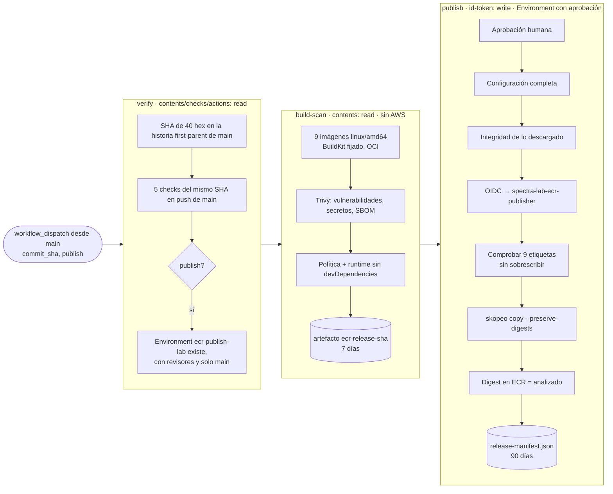

# Publicación de imágenes en Amazon ECR (PR-6)

Guía de operación del workflow manual [`ecr-publish`](../../.github/workflows/ecr-publish.yml). Las decisiones y el modelo de amenazas están en [ADR-AWS-06](../adr/ADR-AWS-06-publicacion-ecr-oidc.md). **Este PR no publica ninguna imagen, no crea el Environment, no cambia la protección de ramas y no crea recursos AWS.** Esos pasos los ejecuta el propietario, con autorización expresa.

## 1. Flujo



`publish` solo se ejecuta con `publish = true`. Con `false`, el workflow verifica, construye y analiza sin contactar con AWS (ensayo).

## 2. Las nueve imágenes

| Imagen                       | Dockerfile y contexto                         | Target    | Repositorio ECR         | Etiqueta        |
| ---------------------------- | --------------------------------------------- | --------- | ----------------------- | --------------- |
| `<svc>-service-runtime` (×4) | `apps/<svc>-service/Dockerfile`, `.`          | `runtime` | `spectra/<svc>-service` | `<sha>`         |
| `<svc>-service-migrate` (×4) | ídem                                          | `migrate` | `spectra/<svc>-service` | `<sha>-migrate` |
| `db-ops`                     | `infra/postgres/Dockerfile`, `infra/postgres` | final     | `spectra/db-ops`        | `<sha>`         |

`<svc>` ∈ {identity, catalog, commerce, audit}. Nunca se usa `latest`. `image_tag` (Terraform) = `<sha>`. La correspondencia con Terraform y con los Dockerfiles la comprueba `scripts/tests/test_images_config.py`.

## 3. Preparación (propietario, una vez, con autorización)

### 3.1 Repositorios, rol y proveedor OIDC (Terraform, raíz `infra/terraform/publisher`)

> [!WARNING]
> **Desde PR-6.2, la publicación no se habilita en `environments/lab`.** Antes, `enable_ecr_publisher = true` estaba en la raíz del laboratorio completo: un `apply` allí habría creado **216 recursos** (RDS, ALB, CloudFront, WAF, ECS, endpoints…), no solo el rol. Ahora los 5 repositorios ECR y el rol publicador están en una raíz propia, [`infra/terraform/publisher`](../../infra/terraform/publisher/README.md), con su propio state, que solo puede crear ECR y el rol OIDC (lo comprueba `scripts/check_state_ownership.py` en la CI). `lab` ya no declara esas variables y lee los repositorios con `data "aws_ecr_repository"`. No hace falta `-target`.

Orden, cada paso con autorización expresa del propietario:

1. **`infra/terraform/bootstrap`**: bucket del state, auditoría de sus accesos con CloudTrail (R-PR5-26) y presupuesto de la cuenta (D7). Es la primera raíz que se aplica.
2. **`infra/terraform/publisher`** (esta guía):
   1. Consulta de solo lectura: ¿la cuenta ya tiene el proveedor OIDC de GitHub? (`aws iam list-open-id-connect-providers`).
   2. En `publisher/terraform.tfvars` (no versionado):
      - `enable_ecr_publisher = true` (con `false` solo se crean los 5 repositorios);
      - si el proveedor ya existe: `create_github_oidc_provider = false`. Terraform lo **lee por su URL** y exige que acepte la audiencia `sts.amazonaws.com`; no lo importa ni lo administra (D3).
   3. Comprobar que el prefijo inmutable sigue siendo el de `github_oidc_subject_prefix`: `gh api repos/Torres21C/spectra-shop/actions/oidc/customization/sub`.
   4. `terraform init -backend-config=backend.hcl` (clave `spectra-shop/publisher/terraform.tfstate`), `terraform plan -out=tfplan` y revisión: **solo** `aws_ecr_repository` y `aws_ecr_lifecycle_policy` (5 de cada uno), `aws_iam_role`, `aws_iam_role_policy` y, si no existía, `aws_iam_openid_connect_provider`; 0 cambios y 0 destrucciones. Después, `apply` con aprobación. Resultado: el rol `spectra-lab-ecr-publisher` y la salida `ecr_publisher_role_arn`.
3. **`environments/lab`**: solo para el despliegue (PR-7), nunca para publicar.

Los repositorios cifran con la clave administrada por AWS `aws/ecr` (D2): el rol publicador no tiene permisos de KMS y P-PUB-1 confirma que no los necesita.

### 3.2 GitHub Environment `ecr-publish-lab` (antes del primer `publish = true`)

En _Settings → Environments → New environment_, o con la API como administrador:

| Ajuste                         | Valor                                                                                                                              |
| ------------------------------ | ---------------------------------------------------------------------------------------------------------------------------------- |
| Nombre                         | `ecr-publish-lab` (exacto: forma parte del `sub` de OIDC)                                                                          |
| Required reviewers             | Al menos una persona (el propietario). Recomendado: _Prevent self-review_ si hay otro revisor                                      |
| Allow administrators to bypass | **Desactivado** (recomendado)                                                                                                      |
| Deployment branches and tags   | _Selected branches and tags_ → solo la rama `main` (tipo _branch_)                                                                 |
| Environment variables          | `AWS_ACCOUNT_ID` = cuenta (12 dígitos); `AWS_REGION` = `us-east-1`; `AWS_ECR_PUBLISHER_ROLE_ARN` = salida `ecr_publisher_role_arn` |
| Environment secrets            | **Ninguno**                                                                                                                        |

`verify` comprueba revisores, política de ramas y existencia; `publish`, las tres variables. Un Environment creado automáticamente por GitHub (sin protección) **no pasa** `verify`.

### 3.4 Requisito de configuración OIDC de GitHub

El rol confía en un `sub` exacto: `repo:Torres21C@84191196/spectra-shop@1457499804:environment:ecr-publish-lab`.

- **Formato inmutable:** `OWNER@ID_PROPIETARIO/REPO@ID_REPOSITORIO`. GitHub lo aplica a este repositorio (`"use_immutable_subject": true`, `"use_default": true`).
- **Comprobación previa, antes de cada `apply`:**

  ```sh
  gh api repos/Torres21C/spectra-shop/actions/oidc/customization/sub
  # {"use_default":true,"use_immutable_subject":true,"sub_claim_prefix":"repo:Torres21C@84191196/spectra-shop@1457499804"}
  ```

- **Requisitos:**
  - No cambiar la personalización OIDC del repositorio sin actualizar antes `github_oidc_subject_prefix` y aplicar la raíz `infra/terraform/publisher`.
  - Si se añade una plantilla con `include_claim_keys` (p. ej. `job_workflow_ref`, la mejora de R-PR6-07), el `sub` cambia de forma. Primero se actualiza la confianza del rol y después la plantilla; si no, los tokens se rechazan (fallo seguro: no se publica).
  - El nombre del Environment forma parte del `sub`. Si se renombra, hay que cambiar la variable `github_publish_environment` y el literal del workflow (`verify_workflows.py` lo exige).
  - Transferir o renombrar el repositorio cambia los identificadores (R-PR6-09).
- **El formato antiguo `repo:Torres21C/spectra-shop:…` no funciona** con este repositorio: la variable lo rechaza por validación.

### 3.3 Protección de `main` (recomendada; no aplicada en PR-6)

_Settings → Rules → Rulesets → New branch ruleset_, objetivo `main`:

1. _Require a pull request before merging_. Al menos 1 aprobación si hay otro revisor.
2. _Require status checks to pass_: `Lint, tipos, pruebas y build`, `SAST (Semgrep)`, `Secretos (Gitleaks)`, `SCA y SBOM` y `Terraform (validación estática, sin AWS)`, todos de la app GitHub Actions.
3. _Block force pushes_ y _Restrict deletions_.
4. Antes de exigir revisión de _code owners_, corregir `.github/CODEOWNERS`: hoy apunta a `@luisjt`, que no es la cuenta propietaria (`Torres21C`).

`verify` ya exige los 5 checks del commit que se publica; la protección evita, además, que llegue a `main` código sin revisar.

## 4. Ejecución

1. **Ensayo**, sin AWS: _Actions → ecr-publish → Run workflow_ sobre `main`, con `commit_sha` = SHA completo del commit de `main` y `publish = false`. Revisar el resumen (digest y vulnerabilidades) y el artefacto `ecr-release-<sha>`.
2. **Publicación**: el mismo SHA con `publish = true`. El job `publish` espera la aprobación del Environment. Al aprobarlo:
   - obtiene credenciales temporales;
   - publica las imágenes pendientes y verifica los 9 digest;
   - guarda `ecr-release-manifest-<sha>`.
3. **Terraform** (`environments/lab`): `image_tag = "<sha>"`. El despliegue queda fuera de PR-6.

El manifiesto (`spectra-ecr-release/v1`) relaciona, para cada imagen:

- el commit, la ejecución y el actor;
- el repositorio y la etiqueta;
- el digest y las referencias por etiqueta y por digest;
- el sha256 del SBOM y el recuento de vulnerabilidades;
- el estado: `published` o `already-present`.

## 5. Fallos seguros

| Situación                                                                                        | Resultado                                                    |
| ------------------------------------------------------------------------------------------------ | ------------------------------------------------------------ |
| Workflow lanzado desde otra rama                                                                 | `verify` no se ejecuta (`if`) y el script también lo rechaza |
| SHA mal formado o con caracteres extra                                                           | `verify` falla; las entradas nunca se interpolan en `run:`   |
| SHA de una rama de feature (ancestro de `main` pero no first-parent)                             | `verify` falla                                               |
| Falta un check, falló o procede de una ejecución de PR                                           | `verify` falla                                               |
| Environment inexistente, sin revisores o abierto a otras ramas                                   | `verify` falla (con `publish = true`)                        |
| Imagen de otra plataforma o de otro commit, o blob alterado                                      | `build-scan` o `publish` fallan                              |
| CRITICAL, HIGH con corrección, HIGH sin excepción válida o secreto en la imagen                  | `build-scan` falla                                           |
| `devDependencies` en una imagen runtime                                                          | `build-scan` falla                                           |
| Faltan `AWS_ACCOUNT_ID`, `AWS_REGION` o `AWS_ECR_PUBLISHER_ROLE_ARN`, o el ARN no es el esperado | `publish` falla antes de pedir el token                      |
| El token OIDC no es aceptado (otro `sub` o rol inexistente)                                      | `configure-aws-credentials` falla; nada se publica           |
| Identidad distinta del rol publicador                                                            | `publish` falla antes de iniciar sesión en ECR               |
| Repositorio inexistente o `AccessDenied` al consultar etiquetas                                  | `publish` falla antes de copiar                              |
| Una etiqueta ya existe con otro digest                                                           | Se aborta **antes de copiar ninguna imagen**                 |
| La etiqueta ya existe con el mismo digest                                                        | Se considera publicada (idempotente)                         |
| El digest en ECR difiere del analizado                                                           | `publish` falla y no genera manifiesto                       |

## 6. Excepciones de vulnerabilidades

Solo para **HIGH sin versión corregida**. Nunca CRITICAL ni HIGH con corrección. Se añaden por PR en `security/image-vulnerability-exceptions.json`:

```json
{
  "policy_version": 1,
  "exceptions": [
    {
      "vulnerability": "CVE-AAAA-NNNNN",
      "package": "nombre-del-paquete",
      "images": ["db-ops"],
      "severity": "HIGH",
      "justification": "Por qué no es explotable aquí o qué lo mitiga (mínimo 20 caracteres).",
      "approved_by": "Torres21C",
      "approved_on": "2026-11-21",
      "expires_on": "2026-12-21"
    }
  ]
}
```

Reglas:

- Identificador exacto CVE o GHSA, paquete exacto e imágenes concretas: sin comodines.
- Caducidad de 30 días como máximo desde la aprobación.
- Una excepción mal formada hace fallar el análisis aunque no se use. Una caducada deja de aplicarse.
- Las que no se usan se avisan, para retirarlas.

## 7. Tamaño y retención de los artefactos

Medición local del 2026-11-21: commit `15f4139`, BuildKit `v0.34.2` y `linux/amd64` emulado en Apple Silicon.

| Imagen                               |                                    Archivo OCI |  Capas |
| ------------------------------------ | ---------------------------------------------: | -----: |
| `identity-service` runtime / migrate |                                89,8 / 147,2 MB | 9 / 10 |
| `catalog-service` runtime / migrate  |                                87,7 / 145,1 MB | 9 / 10 |
| `commerce-service` runtime / migrate |                                88,2 / 129,1 MB | 9 / 10 |
| `audit-service` runtime / migrate    |                                83,2 / 124,0 MB | 9 / 10 |
| `db-ops`                             |                                       109,5 MB |     13 |
| **Total**                            | **1 003,9 MB** (57 blobs únicos: **533,2 MB**) |        |

- **Tiempo:** el build de las 9 imágenes tardó 6 min 02 s con emulación; en el runner (amd64 nativo) debería ser menor. El análisis con Trivy, incluida la descarga de la base de datos, tardó menos de 1 minuto.
- **Retención:** artefacto `ecr-release-<sha>` de unos 1,0 GB por ejecución, 7 días; manifiesto de publicación, 90 días.
  - En un repositorio público, GitHub no cobra el almacenamiento de artefactos, pero cualquier usuario puede descargarlos (riesgo R-PR6-03).
  - 7 días cubren el tiempo de aprobación habitual. Si la aprobación tarda más, se vuelve a lanzar el workflow: se reconstruye y se vuelve a analizar, nunca se publica sin análisis.
- **Alternativa segura si el tamaño molesta (no implementada):** unir los 9 archivos en un único layout OCI con los blobs compartidos, usando `skopeo copy --preserve-digests oci-archive:… oci:<layout>:<nombre>`.
  - Reduce el artefacto a unos 533 MB (−47 %) sin reconstruir nada.
  - Los digest no cambian, y `--preserve-digests` lo garantiza.
  - `publish` copiaría desde el layout. Exige actualizar `verify-release`.

## Resultado del ensayo local (2026-11-21)

Se ejecutaron `build-images.sh` y `scan-images.sh` sobre el commit `15f4139`, cuyas imágenes tienen el mismo contenido que las de `main`. Detalle en la evidencia `EV-AWS-PR6-PIPELINE-LOCAL-20261121` de la bóveda.

| Control                                                                                 | Resultado                                                                                                                                       |
| --------------------------------------------------------------------------------------- | ----------------------------------------------------------------------------------------------------------------------------------------------- |
| Build de las 9 imágenes `linux/amd64`                                                   | OK. Un manifiesto OCI por imagen, blobs íntegros, `revision` = commit; las imágenes de servicio usan `USER node` y `db-ops` usa `USER postgres` |
| Publicación simulada en un registro local efímero (skopeo 1.13.3, `--preserve-digests`) | **9/9 digest idénticos** a los analizados; el manifiesto sigue siendo OCI (`application/vnd.oci.image.manifest.v1+json`), sin transformación    |
| Dependencias de desarrollo en `/app` de las imágenes runtime                            | **0** (ADR-AWS-03 verificado en las imágenes reales). Además hay 200 paquetes npm de la imagen base (CLI de npm y yarn) fuera de `/app`         |
| Secretos en las imágenes                                                                | 0                                                                                                                                               |
| SBOM CycloneDX 1.7                                                                      | 9/9 (52 a 434 componentes)                                                                                                                      |
| **Política de vulnerabilidades**                                                        | **BLOQUEA** (615 hallazgos bloqueantes)                                                                                                         |

Ningún hallazgo procede de las dependencias de la aplicación (`/app/node_modules`). Todos vienen de las **imágenes base**:

- **Alpine 3.21.3, fuera de soporte (EOSL según Trivy)**: OpenSSL, musl y zlib, con CRITICAL y HIGH corregidos en versiones posteriores.
- El **CLI de npm** que trae la imagen `node`: `tar`, `minimatch`, `brace-expansion`, `glob`, `pacote` y `sigstore`.
- En `db-ops`, el binario `gosu` de la imagen `postgres` (Go). `psql` no lo necesita.

Con la política aprobada, **las imágenes actuales de `main` no se pueden publicar**. La corrección exige cambiar los Dockerfiles (fuera del alcance de PR-6 y pendiente de decisión del propietario):

1. Actualizar `node:22.x-alpine` y `postgres:16.x-alpine` a una versión de Alpine con soporte, fijada por digest.
2. Retirar el CLI de npm, corepack y yarn de las etapas `runtime` (y valorar hacerlo en `migrate`, que ejecuta Prisma con Node, no con npm).
3. Construir `db-ops` sobre `alpine` con `postgresql16-client` en lugar de la imagen del servidor.

Después hay que repetir el ensayo con `publish = false`.

**PR-6.1 (2026-11-21)** aplica esa corrección: 0 CRITICAL/HIGH en las 9 imágenes, con la política sin cambios. Resultados en [06-diagnostico-imagenes-base.md, §7](06-diagnostico-imagenes-base.md#7-resultado-de-la-remediación-pr-61-2026-11-21-local).

### Contenido de los artefactos (repositorio público)

Cualquier usuario autenticado en GitHub puede descargar los artefactos de un repositorio público durante su retención (7 días para `ecr-release-<sha>` y 90 para el manifiesto). Lo que contienen, revisado en el ensayo local del 2026-11-21:

- **Imágenes OCI:** el mismo código y las mismas dependencias que ya son públicos en el repositorio.
  - Variables de entorno: solo `PATH`, versiones de Node, Yarn y PostgreSQL, `NODE_ENV`, `CHECKPOINT_DISABLE` y `PGDATA`, sin valores sensibles.
  - El historial de las imágenes no contiene secretos.
  - Entre unos 140 000 archivos, ninguno es sensible (`.env`, `.npmrc`, claves, `.aws`, tfvars, state). El único `.pem` es el almacén de CA públicas de Alpine.
- **Informes de Trivy y SBOM:** inventario de paquetes y CVE de las imágenes, información equivalente a la del repositorio.
- **`images.json`, informes de política y manifiesto:** commit, etiquetas, digest y repositorio ECR. **El manifiesto incluye la cuenta de AWS** dentro de la URL del registro: no es un secreto, pero revela el identificador de la cuenta.
- **No hay credenciales:** no hay claves estáticas y las temporales de OIDC no se escriben en archivos. Trivy busca secretos en cada imagen y bloquea si encuentra alguno.

Riesgo aceptado como R-PR6-03. Si en el futuro las imágenes llegan a contener algo no público, se cambia a un registro intermedio privado.

## 8. Pruebas en AWS pendientes

| ID      | Prueba                                                             | Resultado esperado                                                                                    |
| ------- | ------------------------------------------------------------------ | ----------------------------------------------------------------------------------------------------- |
| P-PUB-1 | Primera publicación real de un commit de `main`                    | 9 imágenes en ECR con el digest analizado; el rol no necesita KMS; `scan_on_push` de ECR sin CRITICAL |
| P-PUB-2 | Repetir el mismo SHA                                               | Las 9 en `already-present`, sin copias                                                                |
| P-PUB-3 | Ejecutar desde otra rama o asumir el rol desde un workflow de PR   | Rechazado (`verify` o STS)                                                                            |
| P-PUB-4 | Retirar el revisor del Environment y ejecutar con `publish = true` | `verify` falla                                                                                        |
