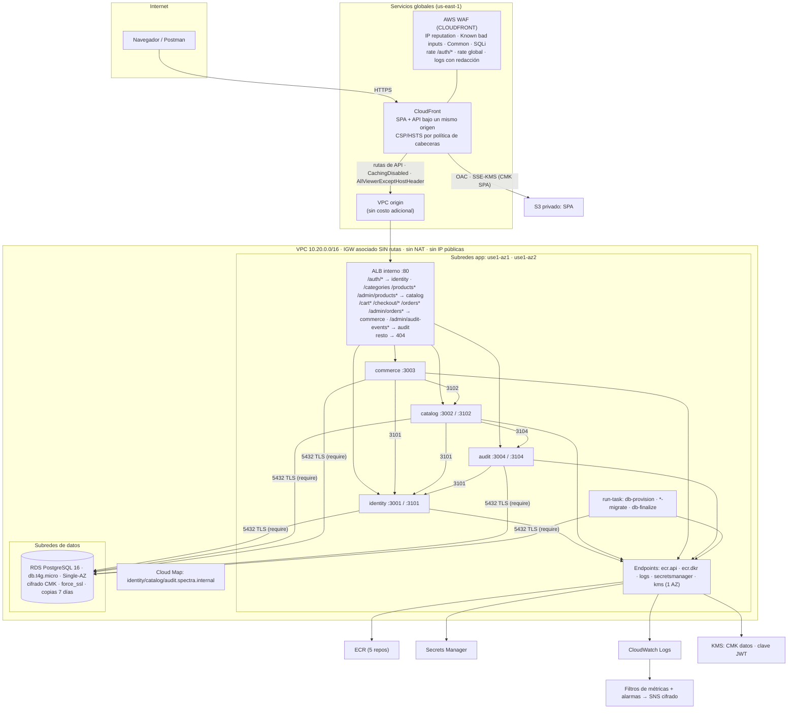

# Arquitectura y matriz de recursos AWS (PR-5)

Estado: **aceptada para el laboratorio académico** (2026-11-21), no aplicada. Decisiones: [ADR-AWS-05](../../../docs/adr/ADR-AWS-05-arquitectura-laboratorio-terraform.md).

## 1. Diagrama

## 2. Matriz de recursos

Recuento aproximado con los valores por defecto: **≈ 215 recursos**. Varía con las variables: ADMIN sintético, correo de alarmas, presupuesto y dominio propio.

| Módulo               | Recursos principales                                                                                                                                                                                                                              | Nº aprox. | Notas de seguridad                                                                   |
| -------------------- | ------------------------------------------------------------------------------------------------------------------------------------------------------------------------------------------------------------------------------------------------- | --------- | ------------------------------------------------------------------------------------ |
| `network`            | `aws_vpc`, 4 `aws_subnet` (2 app + 2 datos, por AZ ID), `aws_internet_gateway` (sin rutas), 2 tablas de rutas + principal sin rutas, `aws_default_security_group` vacío, gateway endpoint S3 (política solo ECR), Flow Logs (log group KMS + rol) | 19        | `map_public_ip_on_launch = false`; ninguna ruta `0.0.0.0/0`                          |
| `security_groups`    | 8 SG (alb, 4 servicios, ops, rds, vpce) y 44 reglas individuales                                                                                                                                                                                  | 52        | Solo referencias a SG y prefix lists; ningún CIDR                                    |
| `endpoints`          | 5 interface endpoints con DNS privado                                                                                                                                                                                                             | 5         | 1 AZ por defecto (variable)                                                          |
| `kms`                | CMK de datos (rotación anual) y clave asimétrica de JWT, con alias; lectura de la clave pública                                                                                                                                                   | 4         | Políticas con delegación en IAM y principales de servicio acotados                   |
| `database`           | `aws_db_instance`, subnet group, parameter group, 2 log groups exportados                                                                                                                                                                         | 5         | `publicly_accessible = false`, maestro gestionado por RDS, protección contra borrado |
| `secrets`            | 8 secretos de rol, 2 tokens, ADMIN sintético opcional, y sus versiones                                                                                                                                                                            | 20–22     | Valores efímeros + write-only                                                        |
| `registry`           | 5 `aws_ecr_repository` + políticas de ciclo de vida                                                                                                                                                                                               | 10        | `IMMUTABLE`, `scan_on_push`, KMS                                                     |
| `alb`                | ALB interno, 4 target groups, listener HTTP, 5 reglas                                                                                                                                                                                             | 11        | `drop_invalid_header_fields`, `desync_mitigation_mode = strictest`, 404 por defecto  |
| `edge`               | Bucket S3 + controles, CMK SPA + política, OAC, VPC origin, 2 políticas de cabeceras, distribución, Web ACL, log group y registro de WAF; alias Route 53 opcional                                                                                 | 19–21     | Block Public Access, solo TLS, OAC con `SourceArn`                                   |
| `observability`      | 10 log groups, 4 filtros de métricas, tema SNS (KMS), 12 alarmas, presupuesto                                                                                                                                                                     | 27–29     | Retención 30 días                                                                    |
| `ecs`                | Clúster Fargate, Cloud Map (espacio + 3 servicios), 10 roles de ejecución + políticas, rol de tarea de Identity, 4 + 6 task definitions, 4 servicios                                                                                              | 42        | Sin IP pública, sin ECS Exec, `drop ALL`, raíz de solo lectura en los servicios      |
| `bootstrap` (aparte) | Bucket del state, CMK, controles y política                                                                                                                                                                                                       | 9         | `prevent_destroy`, solo TLS, SSE-KMS obligatorio                                     |

## 3. Correspondencia con el código (verificada en `main` a0f8052)

| Elemento                             | Origen en el código                                                                                                                                 | Uso en Terraform                                                                                     |
| ------------------------------------ | --------------------------------------------------------------------------------------------------------------------------------------------------- | ---------------------------------------------------------------------------------------------------- |
| Puertos 3001–3004 / 3101, 3102, 3104 | `apps/*/src/main.ts` (`PORT`, `INTERNAL_PORT`)                                                                                                      | Target groups, SG y `portMappings`                                                                   |
| 24 rutas públicas                    | Decoradores `@Controller`/`@Get`/`@Post`…                                                                                                           | 10 comportamientos de CloudFront y 5 reglas del ALB; `/health*`, `/docs*`, `/internal/*` sin enrutar |
| `/health/ready`                      | `health.controller.ts` (ADR-AWS-04)                                                                                                                 | Health check de los target groups                                                                    |
| Variables de cada servicio           | `identity.config.ts`, `admin.config.ts`, `inventory.config.ts`, `commerce.config.ts`, `audit/config.ts`, `identity-public-key.ts`, `trust-proxy.ts` | `environment` y `secrets` de `modules/ecs/workloads.tf`                                              |
| Jobs DT-09                           | `compose.yaml` (`postgres-provision`, `*-migrate`, `postgres-finalize`), `infra/postgres/Dockerfile`                                                | 6 task definitions de operación con las mismas órdenes                                               |
| Imágenes `runtime` / `migrate`       | Dockerfiles (ADR-AWS-03)                                                                                                                            | `:<sha>` y `:<sha>-migrate`                                                                          |
| Formato de contraseñas               | `provision-service-roles.sql` (`^[0-9a-f]{32,128}$`, distintas)                                                                                     | 64 hex por rol                                                                                       |
| ADMIN sintético                      | `identity-service/src/database/seed.ts` (≥ 16 caracteres)                                                                                           | Contraseña efímera de 32 caracteres                                                                  |
| Eventos de log                       | `checkout_saga_stuck`, `inventory_fulfillment_stuck`, `identity_unhandled_exception`, `audit_relay_deferred`                                        | Filtros de métricas y alarmas                                                                        |
